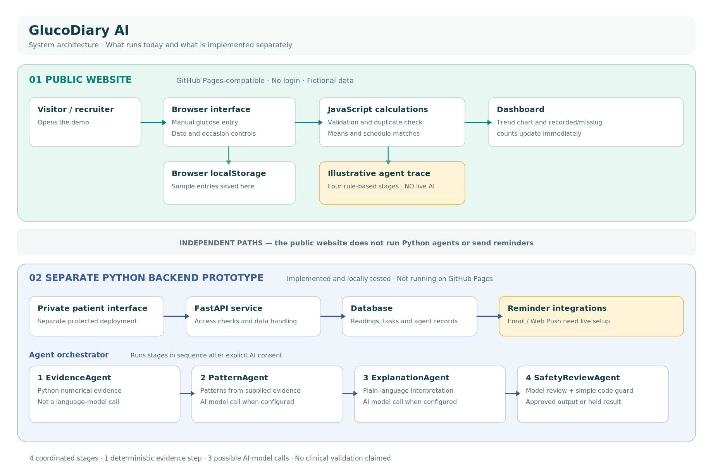

# GlucoDiary AI

**A browser-based diabetes monitoring demo with a separately implemented multi-agent backend prototype.**

I started this project after seeing how awkward it can be to keep track of blood glucose checks when a doctor's schedule changes from day to day. The idea was to make the recording part straightforward and give people a clearer view of the information they have collected. I also wanted to explore where AI agents could help explain the results without asking a language model to perform the actual calculations.

**[Try the public demo](https://YOUR-USERNAME.github.io/glucodiary-ai/)** · [How it works](ARCHITECTURE.md) · [Tests and limitations](EVALUATION_REPORT.md)

> **Before publishing:** replace `YOUR-USERNAME` in the demo link above with your GitHub username. If your repository has a different name, update that part of the URL too.

The public website uses *fictional* patient data. There is no login and it is not intended for medical decisions.

## What you can try

The demo opens directly in a browser. You can:

1. **Record a reading:** enter a fictional glucose value, date and testing occasion. The form checks the input and prevents duplicate entries for the same date and occasion.
2. **See the calculations update:** the chart, average and recorded/missing counts change when a reading is added or deleted.
3. **Inspect the testing calendar:** the example contains 28 planned slots over 14 days, with a daily breakfast check and an additional rotating check.
4. **Try optional features:** switch on a fictional supplement tracker, preview a reminder message, or filter a small set of meal ideas by cuisine and selected ingredients/allergens.
5. **Run the workflow trace:** see the evidence, pattern, explanation and safety stages, along with the numbers used in the example summary.

You can reset the example to its original state. Changes stay in your own browser storage on the hosted demo; they are not sent to a shared database. Please do not enter real health information.

## Architecture at a glance



The distinction between these two paths is important:

| Part | Current behaviour |
| --- | --- |
| **Public GitHub Pages demo** | Real form validation, descriptive glucose calculations, charts, browser-local sample storage, and a **simulated** four-stage trace. |
| **Python backend prototype** | FastAPI routes, database models, scheduling and reminder code, plus an orchestrated agent workflow. It was tested locally with a **mocked AI provider**; it is **not** running on the public website. |
| **External services** | Live AI calls, delivered emails, iPhone push notifications and a hosted private database require separate configuration and verification. |

[See the detailed architecture and execution sequence](ARCHITECTURE.md).

## How many agents are there?

The **backend is organised as four stages**, managed by a Python orchestrator in `app/agents.py`:

| Stage | What it does | How it works |
| --- | --- | --- |
| **1. EvidenceAgent** | Computes counts and descriptive statistics from stored readings. | Python calculations; **not an LLM call**. |
| **2. PatternAgent** | Describes patterns supported by that evidence. | LLM call when configured. |
| **3. ExplanationAgent** | Produces a plain-language account and possible questions for a clinician. | LLM call when configured. |
| **4. SafetyReviewAgent** | Reviews the explanation and may hold it back. | LLM call plus a simple code-based safety guard. |

So there are **four coordinated stages, of which three can call an AI model**. The public site's trace uses JavaScript rules to *illustrate* this sequence. A trace appearing on GitHub Pages is not proof that a live AI model was invoked.

## How the code is organised

| File | Role |
| --- | --- |
| `index.html` | Self-contained, no-login public demonstration served by GitHub Pages. |
| `docs/demo-core.js` | Pure JavaScript schedule creation, reading validation, numerical summaries and recipe matching. |
| `docs/demo.js` | UI event handlers, charts, browser-local state and simulated agent trace. |
| `docs/demo.css` | Responsive frontend styles for the modular source version. |
| `app/main.py` | Separate Python API endpoints and protected application routes. |
| `app/services.py` | Backend validation, schedules, deterministic statistics and CSV export. |
| `app/agents.py` | Four-stage orchestration and agent execution records. |
| `app/notifications.py` | Reminder dispatch with external email/Web Push integrations. |
| `app/models.py`, `app/db.py` | Database models and session setup. |
| `tests/` | Python, Node.js and browser interaction tests. |

The code in `docs/` is supplied in separate files for inspection and testing. The root `index.html` bundles the public demo so it can be hosted as a single static file. GitHub Pages does not execute anything inside `app/`.

## How I evaluated it

The following checks were rerun against the local repository on **19 November 2026**:

| Test level | Result | What it establishes |
| --- | --- | --- |
| Python `pytest` | **49 passed** | Backend validation, API, schedules, storage, mocked provider orchestration and mocked notification dispatch. |
| Node.js tests | **20 passed** | Frontend calculations, date/duplicate validation, filtering and state behaviour. |
| Chromium interactive scenarios | **10 passed**, plus exception check | Core visitor interactions and a narrow mobile viewport, using injected page content because local navigation was blocked by the test environment. |

These results do **not** establish clinical correctness, successful live AI responses, real-world notification delivery, or a fully tested hosted site.

[Read the evaluation report, including the problems found and fixed](EVALUATION_REPORT.md).

To repeat the automated tests from the repository root (requires Python and Node.js):

```bash
python -m pip install -r requirements.txt
python -m pytest -q
node --test tests/test_recruiter_demo.cjs
node --check docs/demo-core.js
node --check docs/demo.js
```

For the optional Chromium interaction test, install Playwright and its browser, then run `python tests/test_browser_e2e.py`.

## Run or publish the public demo

**Locally:** open `index.html` in Chrome, or serve the repository folder with `python -m http.server 8000` and open `http://localhost:8000/`.

**On GitHub Pages:** open **Settings → Pages**, choose **Deploy from a branch**, select **`main`** and **`/(root)`**, then save. The root `index.html` is the entry point. The exact website URL is shown on the Pages settings screen once deployed.

To show the diagram and documentation on the repository homepage, keep `README.md`, `ARCHITECTURE.md`, `EVALUATION_REPORT.md` and `assets/architecture-overview.png` in the locations shown here. GitHub renders the README, PNG image and Mermaid diagrams automatically. The documentation does **not** automatically appear inside the live app's interface. An optional updated root `index.html` is supplied with this documentation set; replacing your current `index.html` with it adds the architecture image to the public website without changing the existing demo logic.

## Boundaries and next steps

This is a software portfolio prototype, **not a clinical device or a validated treatment assistant**. It uses fictional readings. Meal suggestions are only examples and do not establish allergy safety. The public version neither sends reminders nor calls an AI model.

The next engineering step would be to deploy a protected backend with synthetic test accounts, add real service integration tests, evaluate agent output against reference evidence, and conduct security, accessibility and clinical-safety reviews before considering real patients.

**Project author:** Shirin Lade
